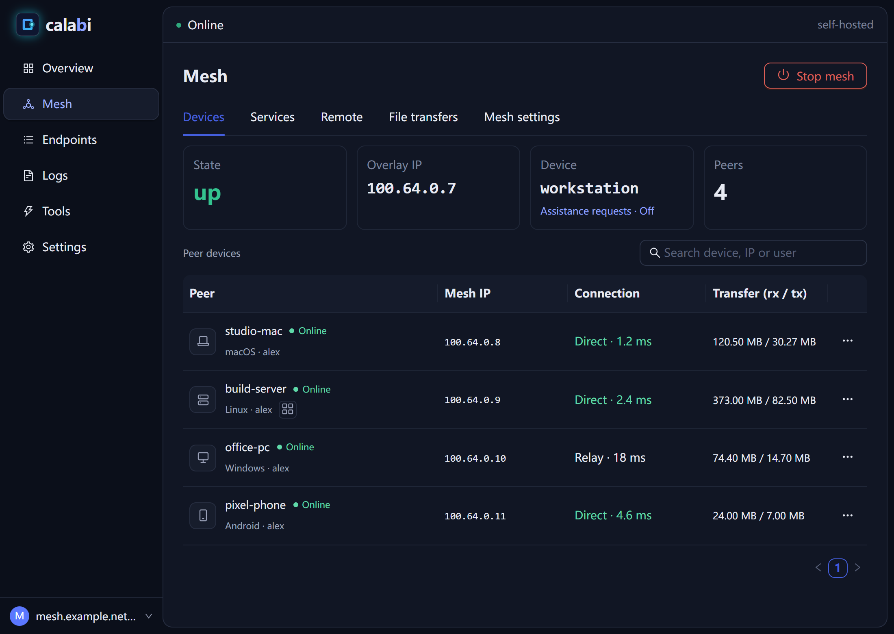

# Calabi Desktop

Native Calabi desktop application for Windows and macOS. The application bundles a tested Calabi daemon, remote desktop components and file transfer helpers.



*Self-hosted mesh in dark appearance, rendered with example device names and addresses.*

Source builds support Windows RDP and Linux SSH access in self-hosted mode. **Remote** shows recent logins when the desktop components are available; use a device's **More** menu to start a connection. Self-hosted RDP requires approved devices in the same mesh, permitted access rules and valid Windows credentials. It does not require a platform account.

Desktop 3.1.0 includes the client-side authorization update. Self-hosted RDP also requires an updated coordinator built from current core source. Standalone coordinator binaries are not republished with this client release.

The RDP access permission does not grant owner-only clipboard-file access. Use **File transfers** to send files between unattributed self-hosted devices.

The product version is `apps/client-desktop/VERSION`. The shared core is maintained in [calabinet/calabi](https://github.com/calabinet/calabi); `apps/client-desktop/core-source.json` pins its version and complete public commit. Core source is fetched for builds, rather than maintained in this repository.

## Download

Use the [desktop releases](https://github.com/calabinet/calabi-desktop/releases/latest) for Windows x64 and macOS universal installers, checksums and signed provenance. The desktop version is independent of the bundled core version.

## Build

Install Python 3.12+, Git, Go 1.25+, Node.js 20+, Rust with the Tauri CLI, and the platform's native build tools. Windows needs PowerShell 7, MSVC and WebView2. Production RDP builds additionally need Python 3.14 (for tar.zst), MinGW-w64 UCRT GCC, CMake, Ninja and curl on PATH; see `tools/rdp-p0/build-windows-helper.py`. macOS needs Xcode Command Line Tools, CMake, pkg-config and Python 3 on PATH. The pinned FreeRDP/OpenSSL sources are built by `tools/rdp-p0/build-macos-sdk.sh`; a separate Homebrew FreeRDP/OpenSSL installation is not required.

```sh
python scripts/products/product.py prepare desktop --destination ../calabi-desktop-build
cd ../calabi-desktop-build
```

On Windows use PowerShell 7:

```powershell
pwsh -NoProfile -File scripts/build-desktop.ps1
```

On macOS, install both Rust targets for a universal build. Place the verified `openssl-3.6.5.tar.gz` and `freerdp-3.33.0.tar.xz` source archives in your local download directory before using offline mode. Set `EDGE_CA` to an existing deployment **public** CA file; the example path below must be replaced:

```sh
rustup target add aarch64-apple-darwin x86_64-apple-darwin
export EDGE_CA="/absolute/path/to/deployment-public-ca.crt"
export CALABI_RDP_DOWNLOAD_DIR="$HOME/Downloads"
export CALABI_RDP_OFFLINE=1
bash scripts/build-desktop.sh --target universal-apple-darwin
bash scripts/package-macos-pkg.sh --daemon bin/calabi
```

Offline mode verifies each archive's fixed SHA-256 and never downloads. Missing or mismatched archives stop the build and preserve existing files. To allow a missing archive to download, unset `CALABI_RDP_OFFLINE`. Without an explicit download directory, verified downloads persist in `$HOME/Library/Caches/Calabi/rdp-sources` across builds; scratch SDK builds are separate and cleaned after bundling. Production builds need your deployment's public CA at the `EDGE_CA` path above.

Builds without a supplied deployment Edge CA are development builds. For a production build, pass the deployment's **public** CA through `-EdgeCa` (Windows) or `EDGE_CA` (macOS). Keep signing keys and passwords outside the source tree. Existing application identifiers, service paths and credential stores are preserved.

The native application displays its own version. The local browser console displays the version of its actual running daemon. Settings list the product and core versions separately.

## Release preparation

Build from a clean public product checkout and the pinned core. Windows stages its installer in `dist/release-desktop`; carry the macOS package to the same release workspace and use `scripts/stage-release-installer.sh` to add it. Update manifests use the existing signing key and desktop channel; the two platforms must be combined before publishing. Set `CALABI_DOWNLOAD_BASE=https://download.calabi.net/desktop` for the official channel, and pass `--platform darwin-universal` when staging the Mac package with the signing key configured. Installer URLs must use the same HTTPS host as the served update manifest. `latest.json` must contain both `windows-x86_64` and `darwin-universal` before the release preview can pass.

```sh
python scripts/products/product.py manifest desktop
```

This records the product version, core version, complete source commits and installer hashes. Development `--core-tree` overrides are explicitly marked and refused for release metadata. Publishing tags, installers, signatures and update manifests is a separate release operation.

## Source and licensing

Calabi source is licensed under Apache-2.0; see `LICENSE` and `NOTICE`. RDP and SSH dependencies have their own notices and pinned build recipes under the source directories. Preserve these notices in redistributions. Native codec availability and platform signing requirements must be verified for each distribution. Ed25519 release signatures do not replace Windows Authenticode or Apple Developer ID signing/notarization.

Report security issues using the [Calabi security policy](https://github.com/calabinet/calabi/blob/main/SECURITY.md).


## Verify release provenance before publishing

From the prepared public build, sign the product manifest with the established release key (kept outside Git), then preview the release:

```powershell
pwsh -NoProfile -File scripts/dev/build.ps1 go run ./scripts/updatekit sign-file --file dist/release-desktop/build-manifest.json --privkey "C:/release-keys/update-private.key" > dist/release-desktop/build-manifest.json.sig
python scripts/products/publish-release.py desktop
```

The preview verifies the manifest signature, installer hashes, product version, fixed core and complete installer set. `--publish` additionally requires an existing public tag at the recorded product source commit. Release tags and publication are separate operations. Desktop update descriptors retain the established desktop signing key and channel.


## Prepared source archive

From the prepared build, create a source archive for another build machine:

```sh
python scripts/products/product.py archive desktop --destination ../calabi-desktop-source.zip --edge-ca "/absolute/path/to/public-ca.crt"
```

The archive includes only recorded public source inputs, their provenance and the optional public CA. It works without a Git checkout and refuses development overrides, changed inputs or private keys. For a formal desktop release, build Windows and macOS from the same selected product source commit; validation installers are separate from release publication.
